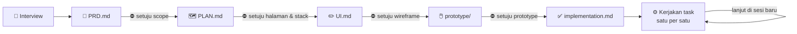

<div align="center">

# 🧭 App Product Planner

**Skill Claude untuk mengubah ide website/aplikasi menjadi rencana, wireframe, prototype, dan kode — langkah demi langkah, dengan persetujuanmu di setiap tahap.**

[](LICENSE)
[](https://docs.claude.com/en/docs/agents-and-tools/agent-skills/overview)
[](https://github.com/upstash/context7)
[](#)

[Cara kerja](#-cara-kerja) · [Instalasi](#-instalasi) · [Cara pakai](#-cara-pakai) · [File yang dihasilkan](#-file-yang-dihasilkan) · [FAQ](#-faq)

</div>

---

## ✨ Kenapa skill ini?

Minta AI "buatkan website" biasanya berakhir dengan kode yang tidak sesuai bayangan, fitur yang tidak diminta, dan library versi lama. Skill ini memaksa urutan kerja yang sehat:

- 🗣️ **Tanya dulu, baru tulis.** Interview singkat (1–2 ronde), bukan tebakan.
- ✅ **Kamu yang memutuskan.** Ada 4 titik persetujuan sebelum satu baris kode aplikasi ditulis.
- 🖼️ **Lihat sebelum dibangun.** Wireframe dan prototype HTML yang bisa diklik untuk semua halaman.
- 📚 **Dokumentasi terbaru.** Wajib cek docs library lewat **MCP Context7**, bukan ingatan model.
- 🇬🇧 **Kode rapi berbahasa Inggris.** Nama variabel, file, komentar, dan commit in English, mengikuti best practices.
- 🪙 **Hemat token.** Lanjut di sesi baru hanya membaca task berikutnya, bukan semua dokumen.

---

## 🔄 Cara kerja



⛔ = agent berhenti, menunjukkan hasil, dan menunggu persetujuanmu. Setuju di satu tahap **bukan** berarti setuju di tahap berikutnya.

| # | Tahap | Yang terjadi |
|---|-------|--------------|
| 1 | **Interview** | 3–5 pertanyaan per ronde: masalah, pengguna, tujuan, fitur wajib, batasan. Tidak menanyakan ulang yang sudah kamu jelaskan. |
| 2 | **PRD** ⛔ | Fitur `FR-xxx` dengan prioritas (Must/Should/Could) dan acceptance criteria yang bisa diuji. |
| 3 | **PLAN** ⛔ | Daftar halaman `SCR-xxx`, arah visual + design tokens, stack yang dicek lewat Context7. |
| 4 | **UI** ⛔ | Alur utama, wireframe ASCII tiap halaman, komponen `COMP-xxx` beserta varian dan state. |
| 5 | **Prototype** ⛔ | HTML/CSS/JS statis untuk semua halaman, bisa dibuka langsung di browser. |
| 6 | **Implementation** | Checklist `TASK-xxx`: setup → tokens → komponen → halaman → data → test → deploy. |
| 7 | **Eksekusi** | Per task: cek docs (Context7) → tulis kode → lint/test/build → centang `[x]` dengan bukti. |

---

## 📦 Instalasi

### Claude Code (CLI / desktop)

```bash
git clone https://github.com/RahmadahyaWeb/product-planner-skill.git
```

```bash
mkdir -p ~/.claude/skills && cp -R product-planner-skill/app-product-planner ~/.claude/skills/
```

Skill langsung tersedia di sesi Claude Code berikutnya. Untuk satu proyek saja, salin ke `.claude/skills/` di folder proyek.

### Claude.ai (web / desktop app)

1. Buat file `.skill` (zip folder skill):
   ```bash
   cd product-planner-skill && zip -r app-product-planner.skill app-product-planner -x 'app-product-planner/evals/*' '*.DS_Store'
   ```
2. Buka **Settings → Capabilities → Skills**, lalu upload `app-product-planner.skill`.

### Wajib: pasang MCP Context7

Skill ini **mewajibkan** Context7 saat memilih stack dan menulis kode. Tanpa Context7, agent akan berhenti dan meminta izinmu.

```bash
claude mcp add context7 -- npx -y @upstash/context7-mcp
```

Lihat [upstash/context7](https://github.com/upstash/context7) untuk klien lain.

### Opsional: Python 3

Script `check_artifacts.py` (stdlib saja, tanpa dependency) dipakai untuk mengecek kelengkapan dan mengambil task berikutnya. Tanpa Python, skill tetap jalan, hanya tanpa pengecekan otomatis.

---

## 🚀 Cara pakai

Cukup ceritakan idenya. Skill aktif otomatis.

**Mulai proyek baru**
```text
Saya mau bikin website company profile untuk bengkel motor saya.
```

**Lanjut di sesi baru (hemat token)**
```text
lanjutkan implementasi dari implementation.md
```
Agent menjalankan `check_artifacts.py --next`, membaca hanya task berikutnya beserta baris yang dirujuknya, lalu langsung bekerja.

**Ubah di tengah jalan**
```text
Tambahkan halaman galeri foto.
Ganti warna utama jadi hijau.
```
Agent menunjukkan dampaknya (halaman, komponen, task yang berubah) dan meminta persetujuan sebelum mengedit apa pun.

---

## 📁 File yang dihasilkan

Di folder proyekmu:

```
my-project/
├── PRD.md               # apa yang dibangun: masalah, pengguna, fitur FR-xxx + acceptance criteria
├── PLAN.md              # halaman SCR-xxx, design tokens, stack, status semua gate
├── UI.md                # alur utama, wireframe tiap halaman, komponen COMP-xxx
├── prototype/           # HTML statis semua halaman, buka index.html di browser
│   ├── index.html
│   ├── README.md
│   ├── assets/          # tokens.css, components.css, app.js, mock-data.js
│   └── pages/           # scr-001-home.html, scr-002-contact.html, ...
└── implementation.md    # blok Progres + checklist TASK-xxx
```

Semua item punya **ID stabil** (`FR-001`, `SCR-001`, `COMP-001`, `TASK-001`) yang saling merujuk, jadi setiap halaman bisa ditelusuri ke fitur, dan setiap fitur ke task.

<details>
<summary><b>Contoh wireframe di UI.md</b></summary>

```
### SCR-001 — Beranda (`/`)
┌──────────────────────────┐
│ [Logo]          [☰ Menu] │  COMP-001 Header
├──────────────────────────┤
│ Judul besar (H1)         │  Hero
│ Subjudul 1–2 baris       │
│ [ Hubungi kami ]         │  COMP-002 Button primary → SCR-002
├──────────────────────────┤
│ ┌──────────┐             │  Layanan: COMP-003 Card × n
│ │ Judul    │             │
│ │ Deskripsi│             │
│ └──────────┘             │
├──────────────────────────┤
│ Footer: kontak · sosmed  │  COMP-004 Footer
└──────────────────────────┘
```

</details>

<details>
<summary><b>Contoh task di implementation.md</b></summary>

```markdown
> **Progres** — terakhir selesai: TASK-004 · berikutnya: TASK-005 · kode: `./web` · stack: Next.js 15

- [x] **TASK-003 — COMP-002 Button + COMP-005 TextField** — ✔ npm test 8/8
- [ ] **TASK-005 — SCR-001: susun sesuai wireframe** — Ref: SCR-001, FR-001, [prototype](prototype/pages/scr-001-home.html) · Dep: TASK-003, TASK-004 · AC: cocok dengan prototype di 360/1280 · Verifikasi: test render + Lighthouse a11y ≥ 90
```

</details>

---

## 🛠️ Script pengecek

```bash
python3 app-product-planner/scripts/check_artifacts.py ./my-project          # laporan kelengkapan
python3 app-product-planner/scripts/check_artifacts.py ./my-project --next   # task berikutnya + pointer file:line
python3 app-product-planner/scripts/check_artifacts.py --self-test           # uji script
```

Yang dicek:
- fitur UI yang belum punya halaman,
- halaman tanpa wireframe atau tanpa file prototype,
- komponen yang tidak dipakai halaman mana pun,
- fitur, halaman, atau komponen tanpa task,
- jumlah task selesai / blocked / ID duplikat.

`--next` hanya memilih task yang tidak `BLOCKED` dan semua dependensinya sudah `[x]`.

---

## 📐 Aturan kode yang dipakai agent

- **English** untuk identifier, nama file, komentar, commit, dan nama test. Teks UI mengikuti bahasa produk.
- Ikuti konvensi resmi framework, yang dicek lewat **Context7**.
- Pakai design tokens dan komponen `COMP-xxx`; tidak ada warna atau spacing hardcoded, tidak ada komponen sekali pakai.
- Validasi input di batas sistem; error ditangani dengan pesan yang jelas.
- Tidak ada secret di kode; pakai env variable dan `.env.example`.
- HTML semantik dan aksesibel (target WCAG 2.2 AA).
- Test untuk logika yang tidak trivial; lint dan build harus lulus sebelum task dicentang.

---

## ❓ FAQ

<details>
<summary><b>Bukankah 4 persetujuan itu lambat untuk website kecil?</b></summary>

Setiap persetujuan mengunci keputusan yang mahal diubah belakangan. Revisi wireframe hanya butuh beberapa detik, sedangkan revisi kode yang sudah jadi butuh jauh lebih lama. Untuk proyek 1–3 halaman, PLAN dan UI boleh ditunjukkan sekaligus (tetap dua persetujuan terpisah).
</details>

<details>
<summary><b>Apakah skill ini membuat backend, login, atau pembayaran sungguhan?</b></summary>

Saat tahap perencanaan dan prototype, tidak. Semua aksi backend disimulasikan dan ditandai `MOCK`. Backend nyata dikerjakan di tahap implementasi, sesuai task yang sudah kamu setujui.
</details>

<details>
<summary><b>Bagaimana kalau saya sudah punya PRD atau desain sendiri?</b></summary>

Bawa saja. Agent memakainya sebagai input, memetakan ke struktur skill, menandai yang kurang, dan menanyakan apakah dokumen itu sudah disetujui.
</details>

<details>
<summary><b>Dokumennya berbahasa apa?</b></summary>

Mengikuti bahasa yang kamu pakai. Skill ini ditulis dalam Bahasa Indonesia, tapi tetap bekerja jika kamu menulis dalam bahasa Inggris. Kode selalu dalam bahasa Inggris.
</details>

<details>
<summary><b>Context7 tidak tersedia di lingkungan saya.</b></summary>

Agent akan berhenti, memberi tahu, dan menyarankan perintah pemasangan. Agent baru melanjutkan tanpa Context7 jika kamu mengizinkan secara eksplisit, dan keputusan itu dicatat di `PLAN.md`.
</details>

---

## 🗂️ Struktur repo

```
app-product-planner/
├── SKILL.md                       # instruksi utama skill
├── references/                    # template, dibaca hanya saat tahapnya
│   ├── prd-template.md
│   ├── plan-template.md
│   ├── ui-template.md
│   ├── prototype-template.md
│   └── implementation-template.md
├── scripts/check_artifacts.py     # pengecek kelengkapan + --next
└── evals/                         # kasus uji perilaku skill
```

---

## 🤝 Kontribusi

Issue dan pull request sangat diterima, misalnya template baru, perbaikan bahasa, atau kasus eval baru di `app-product-planner/evals/`. Sebelum mengirim perubahan pada script:

```bash
python3 app-product-planner/scripts/check_artifacts.py --self-test
```

## 📄 Lisensi

[MIT](LICENSE) © RahmadahyaWeb
