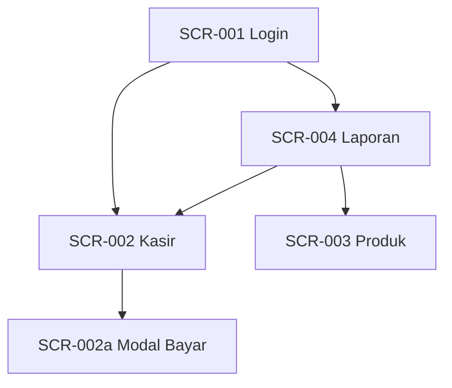

# UI/UX Plan — KasirKu

| Versi | Tanggal | Status | PRD | Design System |
|-------|---------|--------|-----|---------------|
| 1.0 | 2026-10-08 | Disetujui (2026-10-09) | v1.0 | v1.0 |

## 3. Information architecture & sitemap

## 5. User flows
### FLOW-001 — Login
- Sumber: FR-001, US-001 · Actor: semua · Masuk: buka aplikasi
- Langkah: nomor HP → OTP → halaman sesuai peran
- Failure: OTP salah 3x → terkunci 5 menit (AC-002)
- Halaman: SCR-001

### FLOW-002 — Catat penjualan
- Sumber: FR-002, FR-003, BR-001, US-002 · Actor: Kasir, Pemilik
- Langkah: pilih produk (SCR-002) → Bayar → masukkan uang diterima (SCR-002a) → Simpan → toast + kembalian
- Failure: stok kurang → Bayar nonaktif + banner (AC-004)
- Halaman: SCR-002, SCR-002a · Event: sale_completed

### FLOW-003 — Kelola produk
- Sumber: FR-004, BR-002, US-003 · Actor: Pemilik
- Langkah: Produk (SCR-003) → tambah/ubah via form inline → simpan
- Failure: field tidak valid → error inline; Kasir buka /produk → akses ditolak (AC-006)
- Halaman: SCR-003

### FLOW-004 — Lihat laporan harian
- Sumber: FR-005, BR-002, US-004 · Actor: Pemilik
- Langkah: Laporan (SCR-004) → lihat total, jumlah transaksi, terlaris
- Empty: belum ada transaksi hari ini
- Halaman: SCR-004 · Event: report_viewed

FR-006 (backup) non-UI — tidak ada flow.

## 6. Page inventory
| ID | Nama | Jenis | Route | Peran | FR / US | FLOW | Prioritas | Status prototype |
|----|------|-------|-------|-------|---------|------|-----------|------------------|
| SCR-001 | Login | Halaman | /login | Semua | FR-001 / US-001 | FLOW-001 | Must | completed |
| SCR-002 | Kasir | Halaman | /kasir | Kasir, Pemilik | FR-002, FR-003 / US-002 | FLOW-002 | Must | completed |
| SCR-002a | Modal Bayar | Modal | — | Kasir, Pemilik | FR-002 | FLOW-002 | Must | completed |
| SCR-003 | Produk | Halaman | /produk | Pemilik (Kasir: akses ditolak) | FR-004 / US-003 | FLOW-003 | Must | completed |
| SCR-004 | Laporan Harian | Halaman | /laporan | Pemilik | FR-005 / US-004 | FLOW-004 | Must | completed |

Ringkasan: 4 halaman inti, 1 modal, 0 variasi peran (perbedaan peran lewat BottomNav + permission-denied di SCR-003), state khusus: stok kurang, OTP terkunci, laporan kosong, akses ditolak.

## 7. Spesifikasi halaman
### SCR-001 — Login
Tujuan: masuk. Aksi utama: Kirim OTP / Masuk. State: OTP salah, terkunci. Komponen: COMP-001, COMP-002. Breakpoint: 360, 768.

### SCR-002 — Kasir
Tujuan: catat penjualan. Data: grid produk aktif (nama, harga, stok), keranjang. Validasi: jumlah ≤ stok (BR-001). State: stok kurang, keranjang kosong. Komponen: COMP-001, COMP-003, COMP-004, COMP-005, COMP-006, COMP-007, COMP-009. NFR-001, NFR-003.

### SCR-002a — Modal Bayar
Input uang diterima, kembalian dihitung, Simpan. Validasi: uang ≥ total. Komponen: COMP-005, COMP-002, COMP-001.

### SCR-003 — Produk
Tujuan: kelola produk. Daftar produk + form tambah/ubah, nonaktifkan dengan konfirmasi. State: permission-denied untuk Kasir, error validasi. Komponen: COMP-001, COMP-002, COMP-007, COMP-009.

### SCR-004 — Laporan Harian
Tujuan: tutup buku. StatCard total, jumlah transaksi, 3 terlaris. State: empty. Komponen: COMP-008, COMP-009.

## 12. Aksesibilitas
WCAG 2.2 AA (NFR-002) untuk semua SCR.
# Design System — KasirKu

| Versi | Tanggal | Status | Berdasarkan PRD |
|-------|---------|--------|-----------------|
| 1.0 | 2026-10-05 | Disetujui (2026-10-06) | PRD v1.0 |

**Riwayat perubahan**
| Versi | Tanggal | Perubahan | Tokens/COMP terdampak |
|-------|---------|-----------|------------------------|
| 1.0 | 2026-10-05 | Versi awal | semua |

**Sumber kebenaran tokens:** [prototype/assets/tokens.css](prototype/assets/tokens.css)

## 1. Prinsip
1. Satu tangan, satu ibu jari — aksi utama di bawah, target ≥ 44px (NFR-003).
2. Angka uang selalu besar dan jelas.
3. Ramah dan hangat, bukan korporat.

## 2. Arahan visual
Hangat, nuansa kopi. Warna utama cokelat kopi.

## 3. Foundations
### Warna
| Token semantic | Nilai | Fungsi | Kontras |
|----------------|-------|--------|---------|
| `--color-primary` | `--brown-700` #6b3f1d | Aksi utama | 9.0:1 vs putih |
| `--color-primary-hover` | `--brown-800` #4e2c13 | Hover | |
| `--color-on-primary` | #ffffff | Teks di atas primary | |
| `--color-bg` | #faf7f2 | Latar | |
| `--color-surface` | #ffffff | Kartu | |
| `--color-text` | #2b2118 | Teks | 15:1 vs bg |
| `--color-text-muted` | #6b5d50 | Teks sekunder | 5.9:1 vs bg |
| `--color-error` | #b42318 | Error | 6.1:1 vs putih |
| `--color-success` | #027a48 | Sukses | 5.4:1 vs putih |
| `--color-focus-ring` | #1d4ed8 | Fokus | |

### Tipografi
`--font-body` 16/1.5 system-ui; `--font-money` 28px/700; `--font-heading` 20px/600.

### Spacing & radius
`--space-1` 4px · `--space-2` 8px · `--space-3` 12px · `--space-4` 16px · `--space-6` 24px · `--radius-md` 10px.

### Breakpoints
360px (utama), 768px (tablet).

## 4. Komponen
| ID | Komponen | Dibutuhkan oleh |
|----|----------|-----------------|
| COMP-001 | Button (primary, secondary, danger) | semua aksi |
| COMP-002 | TextField (label, help, error) | FR-001, FR-004 |
| COMP-003 | ProductTile | FR-002 |
| COMP-004 | CartBar (total + Bayar, sticky bawah) | FR-002, FR-003 |
| COMP-005 | Modal | FR-002 bayar |
| COMP-006 | Toast | feedback simpan |
| COMP-007 | Banner (error/info) | FR-003, AC-006 |
| COMP-008 | StatCard | FR-005 |
| COMP-009 | BottomNav (per peran) | navigasi |

Spesifikasi ringkas:
- **COMP-001 Button** — states: default, hover, focus-visible (ring 2px `--color-focus-ring`), disabled, loading. Tinggi 48px. `<button>` dengan label deskriptif.
- **COMP-004 CartBar** — sticky bawah, total besar `--font-money`, tombol Bayar; disabled jika keranjang kosong atau stok kurang.
- **COMP-005 Modal** — fokus terjebak, Esc menutup, fokus kembali ke pemicu.
- **COMP-009 BottomNav** — Kasir: [Kasir]. Pemilik: [Kasir, Produk, Laporan].

## 5. Usage guidelines
Rupiah format "Rp18.000". Pesan error menjelaskan cara memperbaiki. Konfirmasi untuk menonaktifkan produk. Target WCAG 2.2 AA [Keputusan DEC-003].
